# Guía de Usuario - Sistema de Control de Asistencia SENA

Bienvenido a la guía oficial de usuario de **SENA Control**, el sistema web institucional para el registro, seguimiento y reporte de asistencia y control de formación de aprendices en el Servicio Nacional de Aprendizaje (SENA).

---

## 1. Introducción

El sistema **SENA Control** permite automatizar el proceso de control de asistencia de las fichas de formación, registrar entradas y salidas de manera manual o electrónica mediante tecnología RFID, gestionar novedades justificadas (excusas médicas o laborales), consultar horarios semanales y generar reportes estadísticos exportables.

### Roles del Sistema

La plataforma cuenta con tres tipos de perfiles, cada uno con funciones adaptadas a su rol institucional:

1. **Administrador:**
   Tiene acceso total a la configuración y gestión general de la sede o centro de formación. Puede crear y editar aprendices, instructores y fichas, revisar excusas, consultar horarios, auditar registros RFID y generar reportes consolidados.
2. **Instructor:**
   Gestiona la asistencia directa de los aprendices pertenecientes a sus fichas asignadas. Puede tomar asistencia manual en el aula, registrar asistencias por RFID, verificar su horario de clases, revisar y responder las excusas radicadas por los aprendices de su formación y generar reportes de su grupo.
3. **Aprendiz:**
   Consulta en tiempo real su historial individual de asistencia (entradas, salidas, retardos e inasistencias), radica excusas ante inasistencias adjuntando soportes digitales (archivos PDF o imágenes), consulta el horario semanal de su ficha y revisa los datos de su grupo de formación.

---

## 2. Acceso a la Plataforma

Para ingresar al sistema, abra su navegador web (Google Chrome, Microsoft Edge o Mozilla Firefox) e ingrese a la dirección web asignada por el centro: `http://localhost/talleres/proyecto_reporte_aprendices/`.

### 2.1. Inicio de Sesión (Login)

La pantalla de bienvenida solicita sus datos de identidad para validar el ingreso.

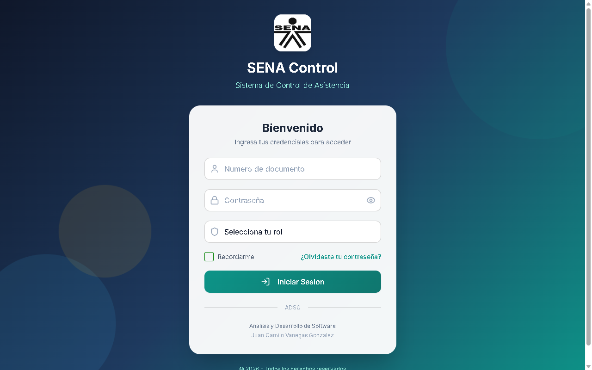

#### Elementos de la pantalla:
1. **Identificación institucional:** Encabezado con el logotipo oficial del SENA y el título del aplicativo.
2. **Número de documento:** Ingrese su número de cédula de ciudadanía o tarjeta de identidad (mínimo 5 caracteres numéricos).
3. **Contraseña:** Escriba su clave de seguridad. 
   - Puede hacer clic en el ícono del ojo para mostrar u ocultar los caracteres escritos.
4. **Selector de Rol:** Despliegue la lista y elija la opción que corresponda a su cargo:
   - *Administrador*
   - *Instructor*
   - *Aprendiz*
5. **Opción Recordarme:** Marque esta casilla si utiliza un equipo personal y desea mantener los datos en el navegador.
6. **Enlace "¿Olvidaste tu contraseña?":** Conduce a la pantalla de recuperación de contraseña.
7. **Botón "Iniciar Sesión":** Al hacer clic, el sistema verifica las credenciales y le redirige automáticamente al panel principal de su rol.

---

### 2.2. Recuperación de Contraseña

Si olvidó su contraseña, puede restablecerla mediante un código de seguridad enviado a su correo electrónico registrado.

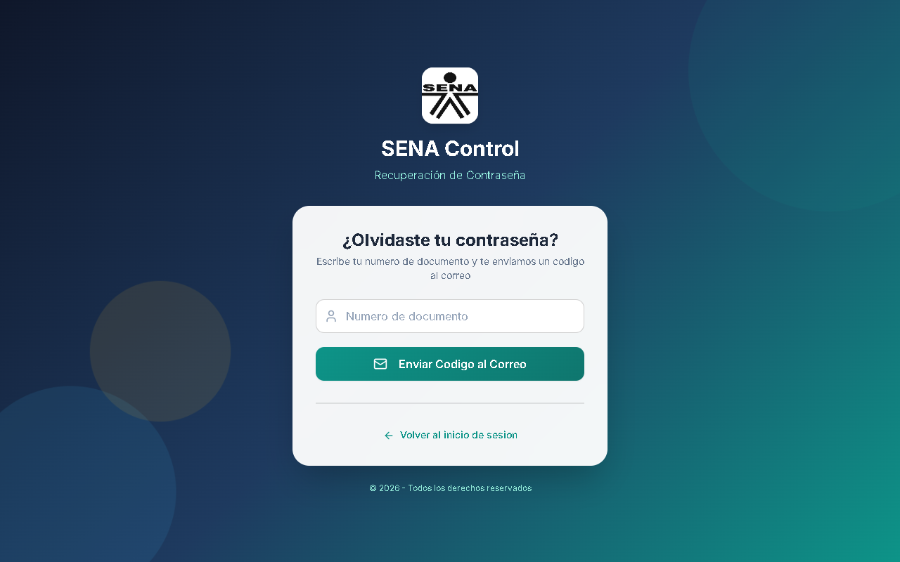

#### Pasos para recuperar el acceso:
1. Haga clic en el enlace **¿Olvidaste tu contraseña?** en la pantalla de inicio de sesión.
2. En el campo **Número de documento**, digite su número de identificación.
3. Presione el botón verde **Enviar Código**.
4. El sistema verificará su documento y enviará un código de seguridad de 6 dígitos numéricos a su bandeja de entrada de correo.
5. Ingrese el código recibido junto con su nueva clave (mínimo 6 caracteres) y confírmela. Tiene un límite de **5 minutos** antes de que el código caduque.
6. Al finalizar, el sistema confirmará el cambio y podrá iniciar sesión normalmente con su nueva clave.
7. Si recuerda su clave o desea salir, puede presionar el enlace inferior **Volver al inicio de sesión**.

---

### 2.3. Cierre de Sesión Seguro

Para proteger su información y la del centro, nunca deje la sesión abierta en equipos compartidos:

1. Ubique su nombre en la esquina superior derecha de la barra superior.
2. Haga clic sobre su nombre o avatar para abrir el menú desplegable.
3. Seleccione la opción roja con ícono de salida: **Cerrar Sesión**.
4. El sistema destruirá la sesión activa y le llevará de regreso a la pantalla de inicio de sesión mostrando un mensaje de confirmación.

---

## 3. Elementos Comunes de la Interfaz

Todas las pantallas del sistema comparten una estructura visual intuitiva compuesta por tres zonas principales: la barra lateral de navegación (Sidebar), la barra superior (Navbar) y el pie de página.

### 3.1. Barra Lateral (Sidebar)
Ubicada a la izquierda de la pantalla, permite desplazarse entre los diferentes módulos disponibles para su rol.
- Muestra el logotipo de **SENA Control**.
- Los botones cambian de color al seleccionarse, indicando la página actual en la que se encuentra.
- En la parte inferior muestra una tarjeta con su nombre y el rol activo.

### 3.2. Barra Superior (Navbar)
Ubicada en la parte alta de la pantalla, permanece visible durante toda la navegación:
1. **Título de página:** Muestra el nombre del módulo en el que se encuentra trabajando.
2. **Buscador global:** Campo para filtrar información rápida.
3. **Campana de notificaciones:** Avisa de novedades pendientes (por ejemplo, excusas que requieren revisión o novedades de asistencia). Al hacer clic, despliega la lista de alertas recientes.

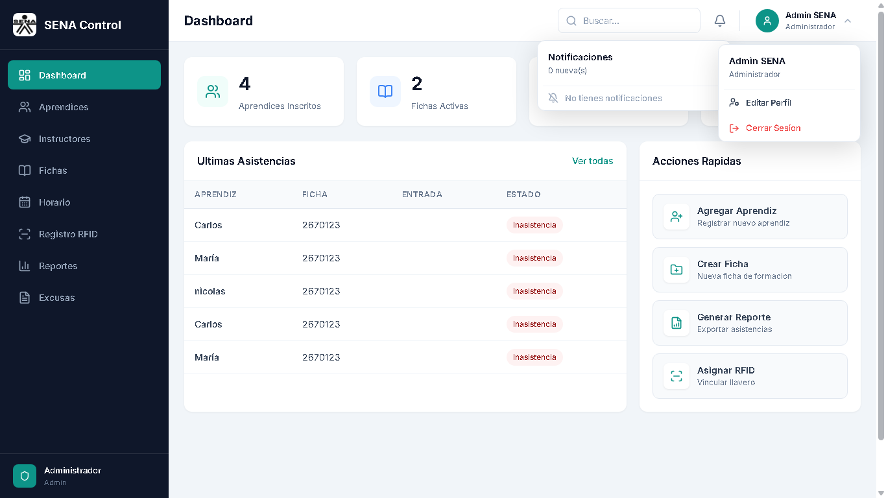

4. **Menú de usuario:** Muestra su nombre, cargo y avatar. Al hacer clic se despliega un menú con dos opciones directas:
   - **Editar Perfil:** Para actualizar su correo y contraseña.
   - **Cerrar Sesión:** Para salir del sistema de forma segura.

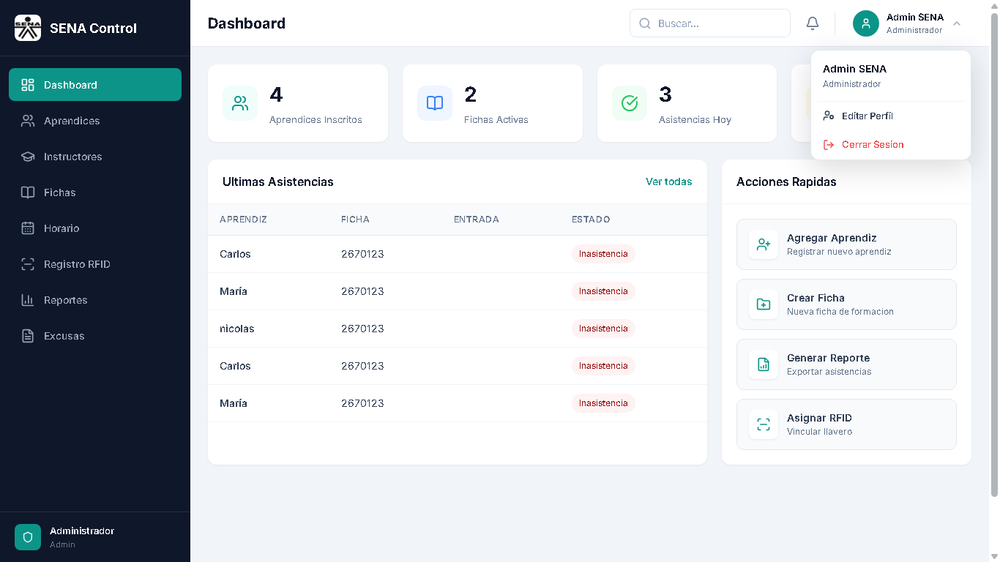

---

## 4. Guía del Rol Administrador

El Administrador supervisa y gestiona de manera centralizada a todos los aprendices, instructores, fichas, novedades y reportes de la institución.

---

### 4.1. Panel Principal (Dashboard)

Es la pantalla inicial que se muestra inmediatamente después de iniciar sesión como Administrador. Ofrece un panorama general del estado del centro de formación en tiempo real.

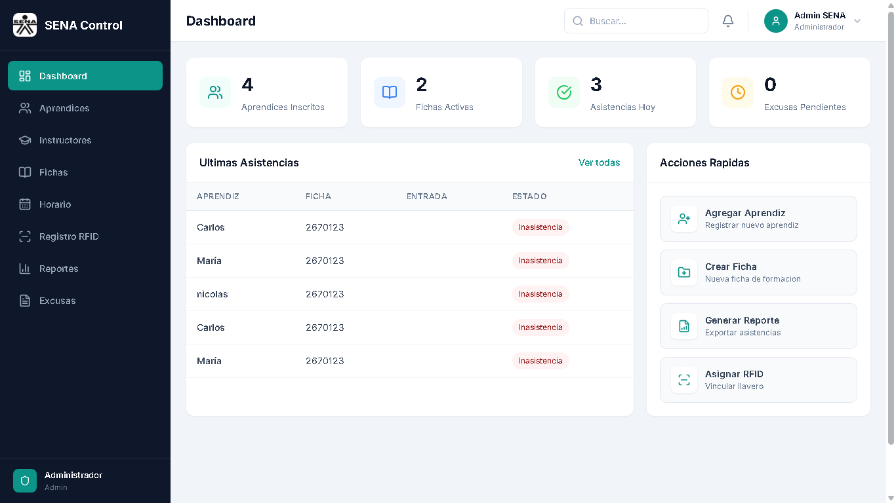

#### Zonas del Dashboard:
1. **Tarjetas de Estadísticas:**
   - **Aprendices Inscritos (Verde azulado):** Cantidad total de aprendices registrados y activos en la base de datos.
   - **Fichas Activas (Azul):** Número de programas de formación y fichas en curso.
   - **Asistencias Hoy (Verde):** Total de registros de asistencia tomados en la fecha actual.
   - **Excusas Pendientes (Ámbar):** Número de justificaciones radicadas que están en espera de revisión.
2. **Tabla de Últimas Asistencias:**
   - Muestra las asistencias más recientes del día con el nombre del aprendiz, la ficha a la que pertenece, la hora exacta de entrada y el estado (*Normal*, *Retardo* o *Inasistencia*).
   - En la parte superior derecha de la tarjeta, el enlace **Ver todas** le lleva directamente al módulo completo de **Reportes**.
3. **Acciones Rápidas:**
   Accesos directos con un solo clic a las tareas más frecuentes:
   - **Agregar Aprendiz:** Abre el catálogo de aprendices para registrar uno nuevo.
   - **Crear Ficha:** Abre la creación de programas y códigos de ficha.
   - **Generar Reporte:** Lleva a los filtros y exportación de asistencia.
   - **Asignar RFID:** Conduce a la vinculación y lectura de tarjetas y llaveros inteligentes.

---

### 4.2. Gestión de Aprendices

Permite buscar, listar, registrar y actualizar los datos de los aprendices de todas las fichas.

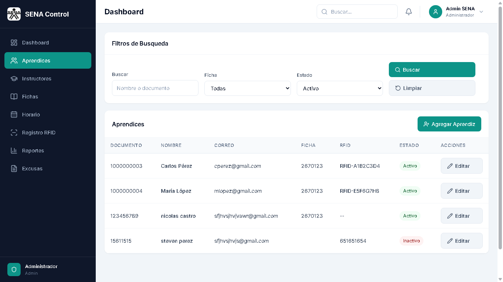

#### Filtros de Búsqueda:
En la tarjeta superior puede filtrar los registros existentes sin recargar manualmente:
- **Buscar:** Escriba parte del nombre o número de documento del aprendiz.
- **Ficha:** Seleccione una ficha específica o deje la opción *"Todas"*.
- **Estado:** Filtre por aprendices en estado *Activo* o *Inactivo*.
- **Botón Buscar:** Aplica los filtros seleccionados a la tabla inferior.
- **Botón Limpiar:** Restablece todos los filtros para mostrar la lista completa.

#### Formulario para Agregar Nuevo Aprendiz:
Haga clic en el botón verde **Agregar Aprendiz** situado en la cabecera de la tabla para desplegar el formulario de registro:

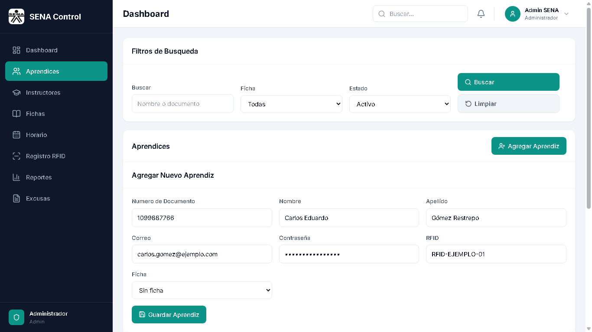

##### Pasos para registrar un aprendiz:
1. Presione el botón **Agregar Aprendiz**.
2. Complete los campos requeridos:
   - **Número de Documento:** Cédula o tarjeta de identidad del aprendiz (único en el sistema).
   - **Nombre:** Nombres del aprendiz (mínimo 5 caracteres).
   - **Apellido:** Apellidos del aprendiz.
   - **Correo:** Dirección de correo electrónico de contacto.
   - **Contraseña:** Contraseña inicial que usará el aprendiz para ingresar al sistema.
   - **RFID:** Si dispone de una tarjeta o llavero de proximidad, acérquelo al lector para que capture automáticamente el código UID; también puede digitarlo manualmente.
   - **Ficha:** Seleccione el código de ficha al que pertenecerá el aprendiz.
3. Presione el botón **Guardar Aprendiz**. El sistema validará que el documento y el RFID no estén duplicados y mostrará un mensaje de éxito.

#### Tabla de Aprendices y Edición:
- Presenta las columnas: *Documento*, *Nombre*, *Correo*, *Ficha*, *RFID*, *Estado* y *Acciones*.
- Para modificar la información de un aprendiz, haga clic en el botón gris **Editar** de la fila correspondiente. Se abrirá el formulario de edición donde podrá actualizar datos personales, asignar una nueva clave (dejándola vacía si no desea cambiarla) o alternar su estado entre *Activo* e *Inactivo*.

---

### 4.3. Gestión de Instructores

Permite administrar el cuerpo docente de la institución, asignando credenciales de acceso y tarjetas RFID.

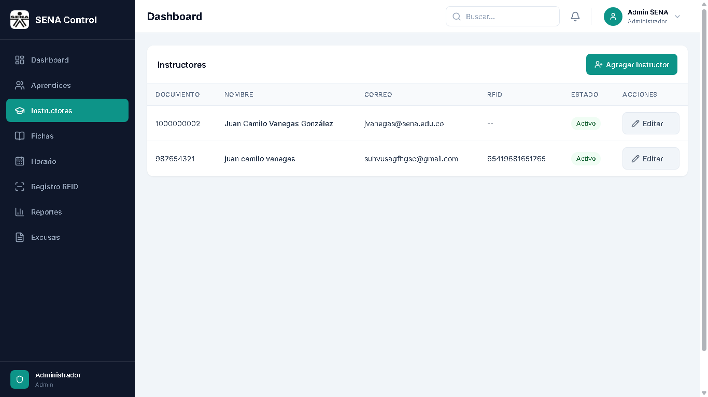

#### Formulario para Agregar Nuevo Instructor:
Haga clic en el botón verde **Agregar Instructor** para abrir la zona de registro:

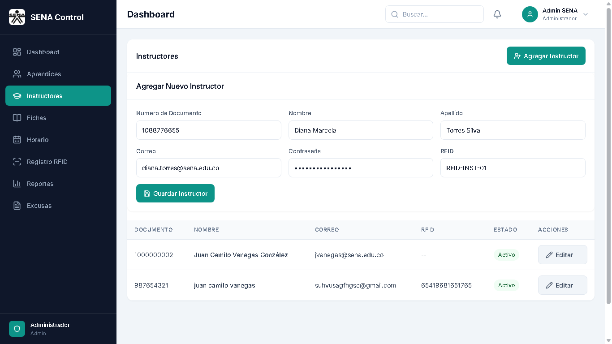

##### Pasos para registrar un instructor:
1. Haga clic en **Agregar Instructor**.
2. Diligencie los campos:
   - **Número de Documento:** Identificación oficial del docente.
   - **Nombre:** Nombres del instructor.
   - **Apellido:** Apellidos del instructor.
   - **Correo:** Correo institucional del SENA.
   - **Contraseña:** Clave de acceso asignada.
   - **RFID:** UID de la tarjeta de identificación del instructor (opcional).
3. Presione **Guardar Instructor**.

#### Tabla y Edición de Instructores:
- La tabla enumera a todos los docentes registrados con su estado actual (*Activo* en verde, *Inactivo* en rojo).
- Presione el botón **Editar** en cualquier fila para modificar los datos del docente, actualizar su correo o inactivar su acceso cuando ya no pertenezca a la institución.

---

### 4.4. Gestión de Fichas de Formación

Permite dar de alta las fichas de formación, vincular el programa académico correspondiente, establecer las horas de inicio y fin de la jornada, y asignar al instructor responsable.

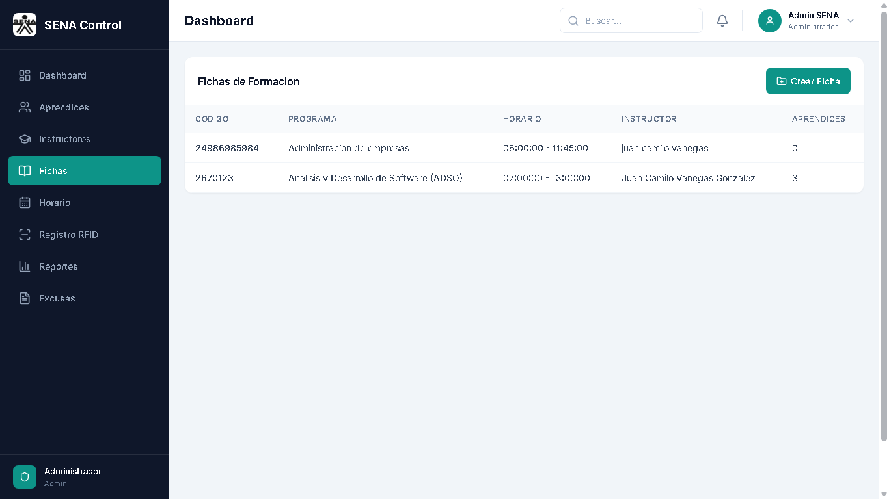

#### Formulario para Crear Nueva Ficha:
Al presionar el botón verde **Crear Ficha**, se despliega el formulario superior:

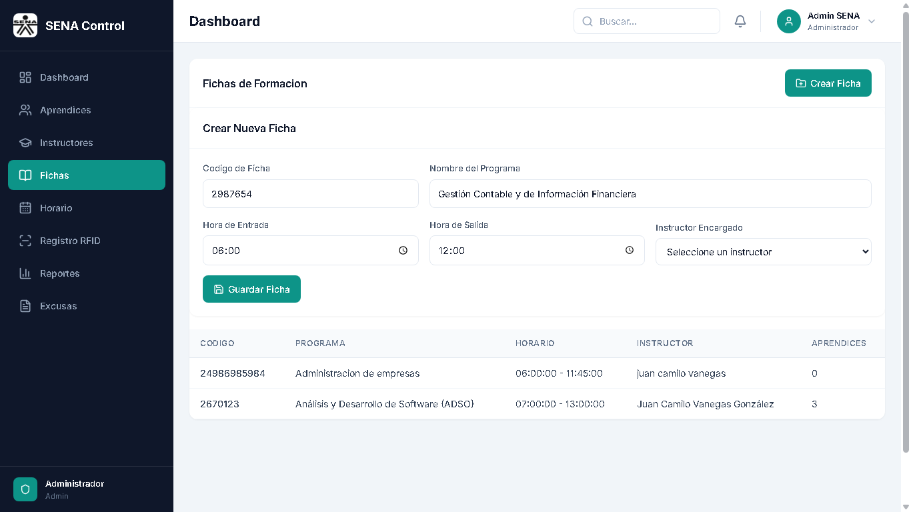

##### Pasos para crear una ficha:
1. Presione **Crear Ficha**.
2. Complete la información académica:
   - **Código de Ficha:** Número de ficha institucional (por ejemplo, `2999876`).
   - **Nombre del Programa:** Nombre de la carrera técnica o tecnológica (por ejemplo, *Análisis y Desarrollo de Software*).
   - **Hora de Entrada:** Hora oficial programada para el inicio de clases (ejemplo: `06:00`).
   - **Hora de Salida:** Hora oficial de finalización de la jornada (ejemplo: `12:00`).
   - **Instructor Encargado:** Seleccione de la lista desplegable al instructor responsable de la ficha.
3. Presione **Guardar Ficha**.

#### Tabla de Fichas:
- Muestra el *Código*, el *Programa*, el *Horario* asignado, el *Instructor* titular y la cantidad total de *Aprendices* inscritos en dicha ficha.

---

### 4.5. Horario Semanal

Permite consultar la distribución de clases de lunes a sábado para cualquiera de las fichas de formación del centro.

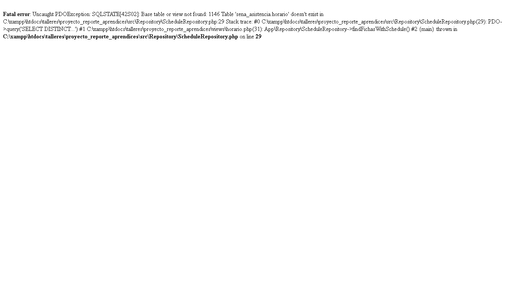

#### Cómo usar la pantalla de horario:
1. **Selector de Ficha:** En la parte superior, seleccione la ficha de formación cuyo horario desea consultar.
2. **Navegación de Semanas:**
   - Use los botones **Anterior** y **Siguiente** para avanzar o retroceder entre semanas del calendario.
   - El sistema resalta los días festivos en color diferenciado.
3. **Grilla Horaria:**
   - La tabla organiza las franjas horarias en la columna izquierda y los días de la semana (Lunes a Sábado) en las columnas siguientes.
   - Cada bloque de clase muestra el nombre de la competencia formativa y el instructor asignado, identificados por una paleta de colores.
4. **Leyenda:** En la parte inferior encontrará la relación entre los colores y los instructores encargados de las asignaturas.

---

### 4.6. Registro de Asistencia RFID

Esta pantalla está diseñada como estación fija de control de acceso. Permite registrar entradas y salidas simplemente acercando una tarjeta o llavero de proximidad al lector conectado al equipo.

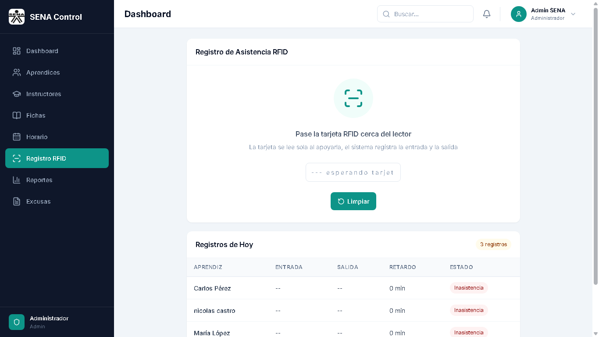

#### Funcionamiento paso a paso:
1. Abra la pantalla **Registro RFID** en el equipo donde esté conectado el lector físico.
2. El cursor se sitúa de forma automática en el campo central de lectura (*esperando tarjeta*).
3. Cuando el aprendiz o instructor acerca su carnet, el lector lee el código UID y envía la solicitud automáticamente:
   - **Primera lectura del día:** Registra la **Entrada**. Si la lectura ocurre después del margen de tolerancia respecto a la hora de entrada de su ficha, el sistema calcula automáticamente los minutos de retardo y marca el estado como **Retardo**.
   - **Segunda lectura del día:** Registra la **Salida**. Si el aprendiz sale antes de la hora programada, el sistema lo registra como **Salida Temprana**.
4. **Retroalimentación visual:**
   - Si la lectura es exitosa, se muestra un recuadro verde con el nombre del usuario, la hora exacta, el estado y los minutos de retardo si aplican.
   - Si la tarjeta no está registrada en el sistema, se muestra un recuadro rojo de advertencia (*No registrado*).
5. **Tabla de Registros de Hoy:** En la parte inferior se listan en tiempo real todas las marcaciones realizadas durante el día actual, con las horas de entrada, salida, retardos y estado general.

---

### 4.7. Reportes de Asistencia y Exportación

Módulo avanzado de auditoría, seguimiento y exportación de datos de asistencia.

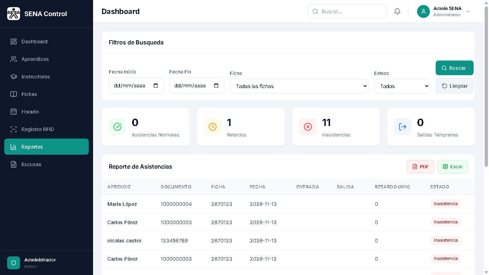

#### Filtros de Auditoría:
Permite filtrar la información con múltiples criterios combinados:
- **Fecha Inicio / Fecha Fin:** Delimite el rango temporal de análisis.
- **Ficha:** Seleccione una ficha específica o consulte todas las fichas.
- **Estado:** Filtre por *Normal*, *Retardo*, *Inasistencia* o *Salida Temprana*.
- Presione **Buscar** para procesar los datos o **Limpiar** para reestablecer los filtros.

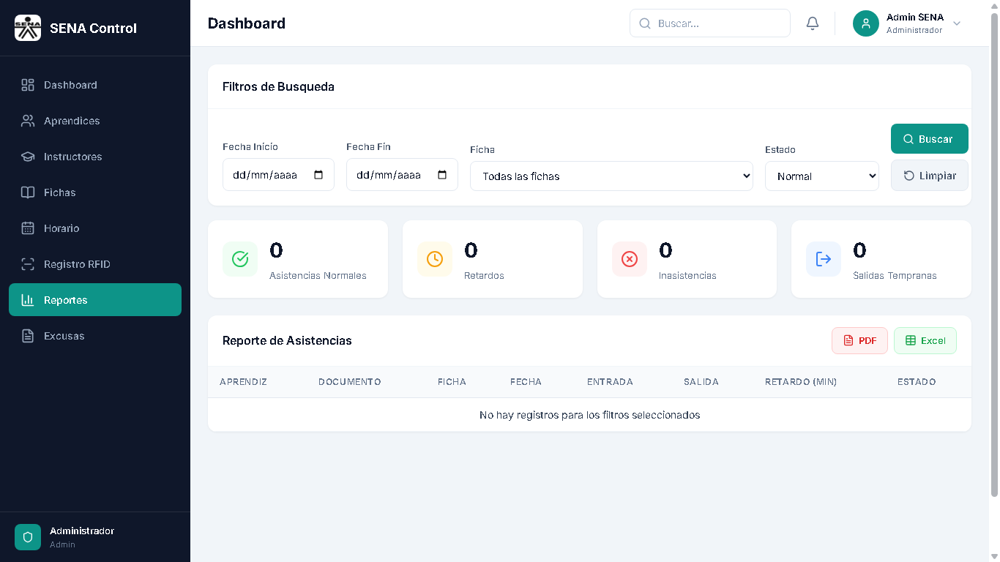

#### Tarjetas de Totales del Reporte:
Bajo los filtros se presentan 4 tarjetas con el balance de los datos resultantes:
- **Asistencias Normales (Verde):** Entradas a tiempo.
- **Retardos (Ámbar):** Llegadas después de la hora oficial.
- **Inasistencias (Rojo):** Ausencias no justificadas.
- **Salidas Tempranas (Azul):** Salidas antes del fin de la jornada.

#### Paginación y Exportación:
1. **Paginación:** La tabla organiza los datos en páginas de 10 registros cada una. En el pie de página puede navegar con los números de página o con los botones **Anterior** y **Siguiente**.
2. **Exportar a PDF:** 
   - Presione el botón rojo **PDF** en la cabecera de la tabla. Se abrirá una nueva pestaña con una versión optimizada para imprimir o guardar como documento PDF que incluye el encabezado institucional, la fecha de emisión, el resumen estadístico y la tabla con los registros filtrados.
3. **Exportar a Excel / CSV:**
   - Presione el botón verde **Excel**. El sistema descargará de forma inmediata un archivo delimitado por punto y coma con codificación UTF-8 BOM (`reporte_asistencias_AAAA-MM-DD.csv`).
   - Este archivo se abre de forma directa y nativa en Microsoft Excel respetando tildes, caracteres especiales y columnas separadas.

---

### 4.8. Gestión de Excusas

Permite a los administradores e instructores revisar, auditar y responder a las justificaciones de inasistencia presentadas por los aprendices.

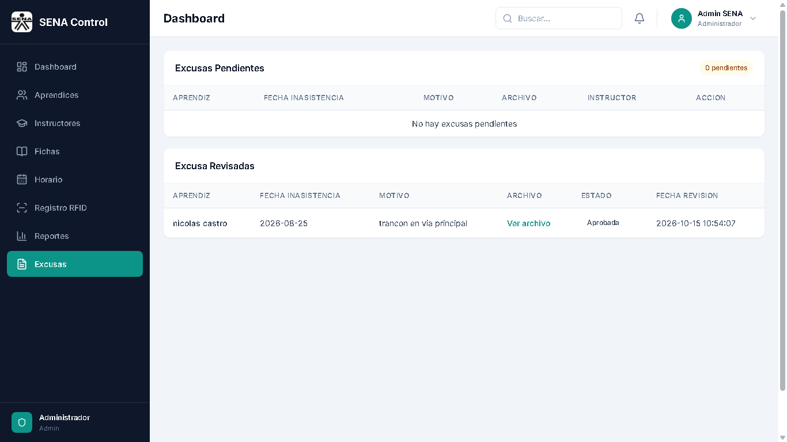

#### 1. Sección Excusas Pendientes:
- Muestra una insignia superior con la cantidad de justificaciones sin resolver.
- La tabla detalla:
  - **Aprendiz:** Nombre completo del estudiante.
  - **Fecha Inasistencia:** Día en el que ocurrió la falta.
  - **Motivo:** Explicación redactada por el aprendiz (médica, calamidad, laboral, etc.).
  - **Archivo:** Enlace directo para abrir y verificar el certificado o soporte adjunto.
  - **Instructor:** Docente asignado a la ficha del aprendiz.
  - **Acción:** Dos botones rápidos:
    - **Aprobar (Verde):** Valida la justificación y actualiza el estado de la falta.
    - **Rechazar (Rojo):** Desestima la excusa en caso de inconsistencias o falta de soportes válidos.

#### 2. Sección Excusas Revisadas:
- Historial permanente de todas las excusas tramitadas con anterioridad.
- Muestra el estado final asignado (*Aprobada* en verde o *Rechazada* en rojo) y la fecha exacta en la que se realizó la revisión.

---

### 4.9. Editar Perfil y Cambio de Contraseña

Permite al Administrador actualizar su correo electrónico personal y cambiar su contraseña de ingreso mediante un mecanismo de doble verificación.

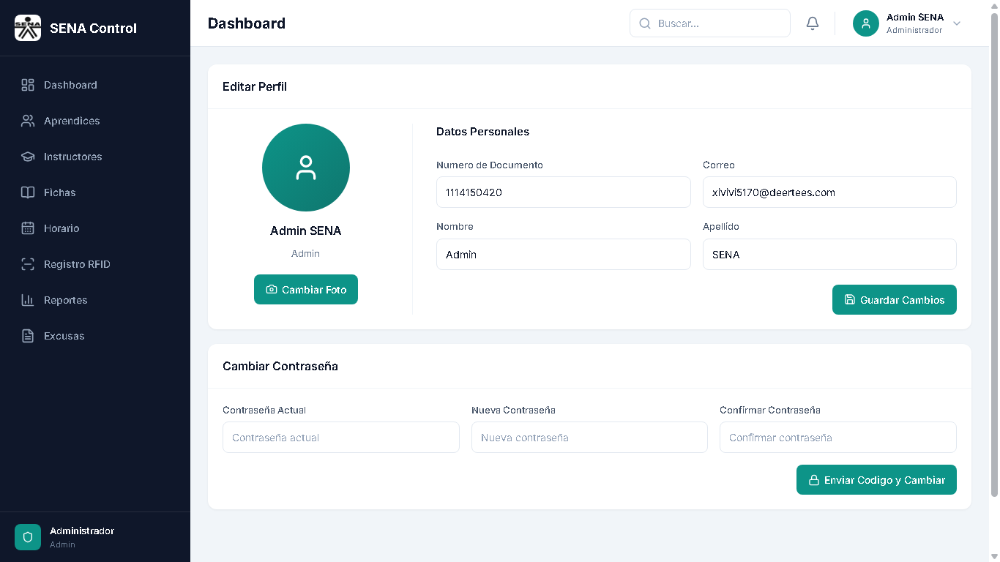

#### 1. Datos Personales:
- Los campos *Número de Documento*, *Nombre* y *Apellido* se muestran bloqueados por seguridad institucional.
- Puede actualizar su dirección de **Correo** escribiendo en el campo correspondiente y presionando el botón **Guardar Cambios**.
- Dispone de un botón **Cambiar Foto** para personalizar su avatar en la plataforma.

#### 2. Cambio Seguro de Contraseña:
Para garantizar que ningún tercero modifique la clave sin autorización, el sistema aplica un protocolo de verificación por correo:
1. En la tarjeta inferior, ingrese su **Contraseña Actual**.
2. Digite la **Nueva Contraseña** (mínimo 6 caracteres).
3. Repita la misma clave en **Confirmar Contraseña**.
4. Presione el botón **Enviar Código y Cambiar**.
5. El sistema validará su clave actual y enviará un código de verificación de 6 dígitos a su correo electrónico registrado.
6. Se habilitará en la pantalla un recuadro con un contador regresivo de **5 minutos** donde deberá escribir el código recibido.
7. Presione **Confirmar Código** para consolidar el cambio definitivo de su contraseña.

---

## 5. Preguntas Frecuentes y Mensajes del Sistema

### ¿Qué significan los estados de asistencia?
- **Normal:** El aprendiz registró su entrada a tiempo antes del límite programado.
- **Retardo:** El aprendiz marcó su ingreso después de la hora oficial de inicio de su ficha. El sistema calcula y almacena la cantidad exacta de minutos de tardanza.
- **Inasistencia:** El aprendiz no registró entrada durante la jornada. El sistema procesa e inserta automáticamente la inasistencia al finalizar el horario.
- **Salida Temprana:** El aprendiz registró su marcación de salida antes de cumplirse el horario oficial de la jornada.

### Mensajes y alertas comunes del sistema:
- **"Acceso denegado (Documento o contraseña incorrectos)":** Verifique que su número de documento no contenga puntos ni espacios y que haya seleccionado el rol correcto en la pantalla de ingreso.
- **"Demasiados intentos. Espera unos minutos e intenta de nuevo":** Por seguridad, el sistema bloquea temporalmente los intentos tras 5 fallos consecutivos durante 5 minutos para evitar ataques automatizados.
- **"Sesión expirada":** Su sesión caducó por inactividad. Vuelva a identificarse en el formulario de inicio de sesión.
- **"Ese número de documento ya está registrado":** No es posible crear dos usuarios con el mismo documento de identidad. Verifique si el usuario ya existe y edítelo en lugar de agregarlo nuevamente.
- **"Ese RFID ya está registrado en otro usuario":** Cada tarjeta o llavero de proximidad es único; debe desvincularlo del usuario anterior antes de asignarlo a uno nuevo.
- **"El código no es correcto / ha expirado":** Al cambiar la clave o recuperar el acceso, asegúrese de ingresar los 6 números antes de que el reloj de 5 minutos llegue a cero.

---

## 6. Pruebas del Sistema

El sistema cuenta con una batería de pruebas automatizadas compuestas por suites **unitarias** y de **integración** ejecutadas bajo PHPUnit 11 y PHP 8.2.

Para consultar el reporte técnico completo, la metodología, la tabla de resultados reales, el detalle por servicio y repositorio, y los hallazgos identificados durante las pruebas, consulte el documento:

👉 **[Informe de Pruebas de Software](../informe-pruebas.md)**

---

*(Fin del módulo Administrador. Continúa con las guías de Instructor y Aprendiz).*
