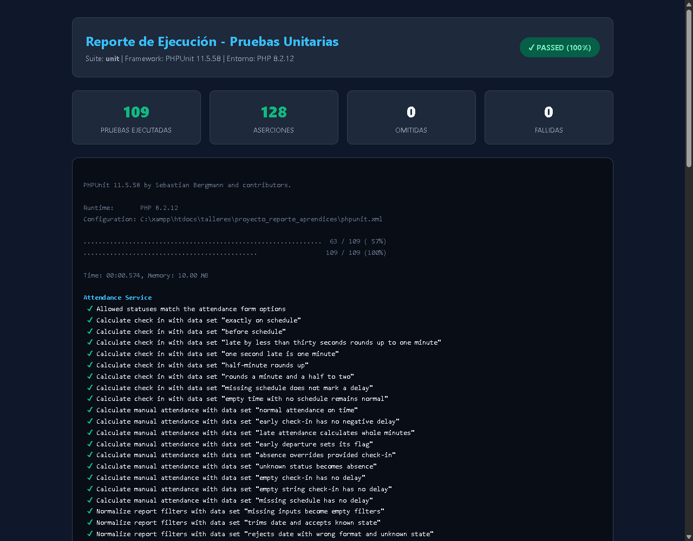
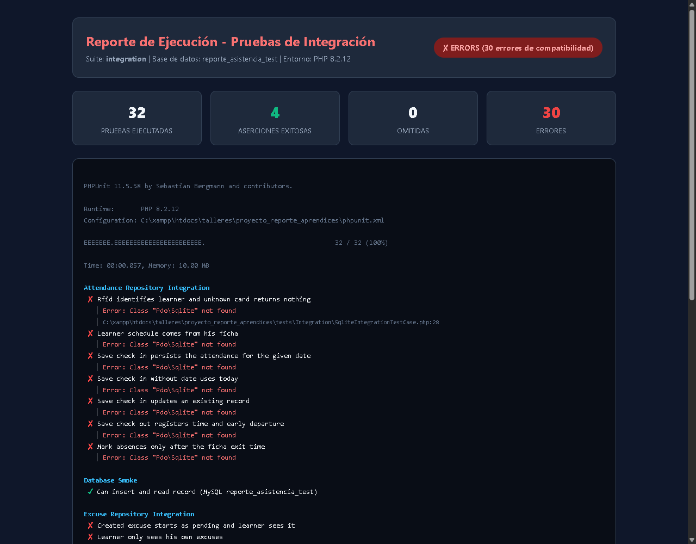

# Informe de Pruebas de Software - SENA Control

**Sistema:** SENA Control - Sistema de Control de Asistencia de Aprendices  
**Entorno de Ejecución:** PHP 8.2.12 | PHPUnit 11.5.58  
**Fecha de Ejecución:** 14 de Noviembre de 2026  
**Base de Datos de Pruebas:** `reporte_asistencia_test` (MySQL en localhost)  

---

## 1. Resumen Ejecutivo

Las **pruebas unitarias** validan el comportamiento aislado de cada clase y método de la capa de servicios (`src/Service`), verificando algoritmos de cálculo, reglas de negocio, normalización de datos y validaciones lógicas sin interactuar con bases de datos ni servicios externos.

Las **pruebas de integración** verifican la interacción entre los repositorios de datos (`src/Repository`) y los motores de persistencia mediante consultas SQL reales (SELECT, INSERT, UPDATE, JOIN), garantizando que las consultas sean sintácticamente correctas y cumplan con las restricciones de integridad relacional.

### Herramientas y Versiones
- **Framework de Pruebas:** PHPUnit 11.5.58 por Sebastian Bergmann.
- **Motor de Lenguaje:** PHP 8.2.12 (CLI win32).
- **Aislamiento de Base de Datos:** Base de datos dedicada `reporte_asistencia_test` en MySQL, con ejecución transaccional revertida al finalizar cada caso.

### Comandos de Ejecución

Para reproducir las pruebas desde la terminal en la raíz del proyecto:

```bash
# Ejecutar suite completa de pruebas unitarias con documentación testdox y advertencias
vendor\bin\phpunit --testsuite unit --testdox --display-warnings

# Ejecutar suite completa de pruebas de integración con documentación testdox y pruebas omitidas
vendor\bin\phpunit --testsuite integration --testdox --display-skipped

# Ejecutar un archivo específico de pruebas
vendor\bin\phpunit tests/Unit/AttendanceServiceTest.php --testdox

# Filtrar y ejecutar una prueba o método específico
vendor\bin\phpunit --filter testCalculateCheckInWithDataSet
```

---

## 2. Tabla de Resultados

Los valores detallados a continuación provienen de la ejecución real de las suites configuradas en `phpunit.xml`:

| Suite de Pruebas | Pruebas Ejecutadas | Aserciones | Omitidas (Skipped) | Fallidas / Errores | Estado Global |
| :--- | :---: | :---: | :---: | :---: | :---: |
| **Unitarias (`unit`)** | **109** | **128** | 0 | 0 | **100% Superadas (OK)** |
| **Integración (`integration`)** | **32** | **4** | 0 | **30** *(Errores de versión)* | **2 Superadas / 30 Errores** |
| **Total General** | **141** | **132** | **0** | **30** | — |

> [!WARNING]
> En la suite de integración, 30 pruebas no pudieron completarse debido a un error de compatibilidad de versión de PHP en la clase base `SqliteIntegrationTestCase`: la clase invoca `new Pdo\Sqlite()`, la cual fue introducida en PHP 8.4/8.5 y no existe en el entorno actual de ejecución (PHP 8.2.12). Las 2 pruebas que utilizan la conexión estándar de PDO (`DatabaseSmokeTest` en MySQL real y `UserRepositoryTest` en SQLite nativo) se ejecutaron con éxito.

---

## 3. Pruebas Unitarias (`src/Service`)

La suite unitaria cubre los 10 servicios que encapsulan las reglas de negocio del sistema:

### 3.1. `AttendanceService` (Gestión y Cálculo de Asistencia)
- **Clase probada:** `App\Service\AttendanceService`
- **Comportamientos cubiertos:** Cálculo de retardos en la entrada según el horario oficial de la ficha; redondeo hacia arriba a un minuto mínimo para cualquier retraso fraccionario; cálculo de salidas tempranas; normalización de filtros de reporte; conteo agrupado por estados; control de paginación y generación de mensajes de retroalimentación para lector RFID.
- **Casos de prueba destacados:**
  1. *Entrada puntual:* Hora programada `07:00:00`, marcación a las `07:00:00` o `06:55:00` $\rightarrow$ Estado: `Normal`, Retardo: `0` minutos.
  2. *Retardo menor a 30 segundos:* Hora programada `07:00:00`, marcación a las `07:00:15` $\rightarrow$ Estado: `Retardo`, Retardo: `1` minuto (redondeo mínimo).
  3. *Validación de paginación:* Tamaño de página igual a `0` o negativo $\rightarrow$ Lanza `InvalidArgumentException` con el mensaje *"Page size must be at least 1"*.

### 3.2. `AuthService` (Autenticación y Sesión)
- **Clase probada:** `App\Service\AuthService`
- **Comportamientos cubiertos:** Enrutamiento automático hacia el dashboard correspondiente según el rol del usuario autenticado; redirección defensiva al login ante roles desconocidos o vacíos; extracción estructurada del perfil en sesión con valores por defecto si faltan claves.
- **Casos de prueba destacados:**
  1. Rol `'Administrador'` $\rightarrow$ Retorna `'admin_dashboard.php'`.
  2. Rol `'Instructor'` $\rightarrow$ Retorna `'instructor_dashboard.php'`.
  3. Rol vacío o inexistente $\rightarrow$ Redirige a `'login.php'`.

### 3.3. `ExcuseService` (Gestión de Excusas Justificadas)
- **Clase probada:** `App\Service\ExcuseService`
- **Comportamientos cubiertos:** Validación de obligatoriedad de fecha y motivo en la radicación; verificación de extensiones de archivos adjuntos (permite PDF e imágenes); control de peso máximo (5 MB); coincidencia de tipo MIME con la extensión; segmentación de contadores de notificaciones según el rol.
- **Casos de prueba destacados:**
  1. Radicación con fecha `'2026-11-13'` y motivo justificado $\rightarrow$ Validación exitosa (`null`).
  2. Archivo adjunto con extensión no autorizada (`.exe`) $\rightarrow$ Retorna `'unsupported_extension'`.
  3. Notificación para Administrador $\rightarrow$ Retorna el conteo total de excusas con estado `'Pendiente'`.

### 3.4. `FichaService` (Creación de Fichas)
- **Clase probada:** `App\Service\FichaService`
- **Comportamientos cubiertos:** Validación de integridad en el formulario de creación de fichas formativas; detección y rechazo de campos omitidos, cadenas vacías o campos diligenciados exclusivamente con espacios en blanco.
- **Casos de prueba destacados:**
  1. Todos los campos completos (`codigo_ficha`, `nombre_programa`, `hora_entrada`, `hora_salida`, `id_instructor`) $\rightarrow$ Retorna `true`.
  2. Campo `codigo_ficha` compuesto únicamente de espacios (`'   '`) $\rightarrow$ Retorna `false`.
  3. Omisión de la hora de salida $\rightarrow$ Retorna `false`.

### 3.5. `PasswordChangeService` (Cambio Seguro de Contraseñas)
- **Clase probada:** `App\Service\PasswordChangeService`
- **Comportamientos cubiertos:** Validación de longitud mínima (6 caracteres); comprobación estricta de coincidencia entre clave nueva y confirmación; verificación de código numérico de 6 dígitos dentro de la ventana de validez de 5 minutos; cálculo del tiempo restante en segundos.
- **Casos de prueba destacados:**
  1. Claves coincidentes con longitud $\ge 6$ $\rightarrow$ Validación exitosa (`null`).
  2. Claves no coincidentes $\rightarrow$ Retorna `'mismatch'`.
  3. Código ingresado posterior a la expiración $\rightarrow$ Retorna `'expired'`.

### 3.6. `PasswordService` (Criptografía y Hashing)
- **Clase probada:** `App\Service\PasswordService`
- **Comportamientos cubiertos:** Generación de hashes seguros con algoritmo bcrypt; verificación de hashes; salting automático independiente; verificación de contraseñas vacías.
- **Casos de prueba destacados:**
  1. Generación de hash para una contraseña $\rightarrow$ El hash resultante es distinto al texto en claro y verifica positivamente con `password_verify`.
  2. Contraseña incorrecta contrastada con el hash $\rightarrow$ Retorna `false`.

### 3.7. `ReportService` (Exportación de Reportes)
- **Clase probada:** `App\Service\ReportService`
- **Comportamientos cubiertos:** Generación de encabezados para archivo CSV; mapeo seguro de registros a filas CSV asegurando cadenas vacías ante campos no definidos (evitando warnings); formateo estándar del nombre del archivo descargable con fecha.
- **Casos de prueba destacados:**
  1. Encabezados $\rightarrow$ `['Aprendiz', 'Documento', 'Ficha', 'Fecha', 'Entrada', 'Salida', 'Retardo (min)', 'Estado']`.
  2. Registro con campos faltantes $\rightarrow$ Mantiene las columnas completas rellenando con valores vacíos.

### 3.8. `ScheduleService` (Estructuración de Horarios)
- **Clase probada:** `App\Service\ScheduleService`
- **Comportamientos cubiertos:** Transformación de registros de base de datos a una matriz horaria de Lunes a Sábado; marcación de festivos; cálculo de fechas límite de semana (lunes a sábado); asignación consistente de colores de paleta para instructores.
- **Casos de prueba destacados:**
  1. Fila con marca de festivo $\rightarrow$ Se separa en la colección de festivos sin interpretarse como horario de clase.
  2. Fecha intermedia $\rightarrow$ Calcula exactamente el lunes de inicio y sábado de finalización.

### 3.9. `SecurityService` (Seguridad Web y CSRF)
- **Clase probada:** `App\Service\SecurityService`
- **Comportamientos cubiertos:** Validación de tokens anti-CSRF para protección contra ataques de falsificación de peticiones en formularios POST; descarte de tokens vacíos o no coincidentes; lógica de limitación de tasa (rate limiting).
- **Casos de prueba destacados:**
  1. Tokens coincidentes y no vacíos $\rightarrow$ Retorna `true`.
  2. Token esperado vacío en sesión $\rightarrow$ Retorna `false`.

### 3.10. `UserService` (Normalización y Filtros de Usuarios)
- **Clase probada:** `App\Service\UserService`
- **Comportamientos cubiertos:** Normalización de criterios de búsqueda de aprendices (recorte de espacios en blanco al inicio y final); normalización del estado (*activo* $\rightarrow$ *Activo*); validación de longitud mínima de 5 caracteres en el nombre del aprendiz sin considerar espacios periféricos.
- **Casos de prueba destacados:**
  1. Búsqueda con espacios `'  carlos  '` $\rightarrow$ Normalizado a `'carlos'`.
  2. Estado en minúsculas `'activo'` $\rightarrow$ Normalizado a `'Activo'`.
  3. Nombre de 4 letras `'Ana'` $\rightarrow$ Retorna error por ser inferior a 5 caracteres.

---

### Salida Completa de Pruebas Unitarias

```text
PHPUnit 11.5.58 by Sebastian Bergmann and contributors.

Runtime:       PHP 8.2.12
Configuration: C:\xampp\htdocs\talleres\proyecto_reporte_aprendices\phpunit.xml

...............................................................  63 / 109 ( 57%)
..............................................                  109 / 109 (100%)

Time: 00:00.574, Memory: 10.00 MB

Attendance Service
 ✔ Allowed statuses match the attendance form options
 ✔ Calculate check in with data set "exactly on schedule"
 ✔ Calculate check in with data set "before schedule"
 ✔ Calculate check in with data set "late by less than thirty seconds rounds up to one minute"
 ✔ Calculate check in with data set "one second late is one minute"
 ✔ Calculate check in with data set "half-minute rounds up"
 ✔ Calculate check in with data set "rounds a minute and a half to two"
 ✔ Calculate check in with data set "missing schedule does not mark a delay"
 ✔ Calculate check in with data set "empty time with no schedule remains normal"
 ✔ Calculate manual attendance with data set "normal attendance on time"
 ✔ Calculate manual attendance with data set "early check-in has no negative delay"
 ✔ Calculate manual attendance with data set "late attendance calculates whole minutes"
 ✔ Calculate manual attendance with data set "early departure sets its flag"
 ✔ Calculate manual attendance with data set "absence overrides provided check-in"
 ✔ Calculate manual attendance with data set "unknown status becomes absence"
 ✔ Calculate manual attendance with data set "empty check-in has no delay"
 ✔ Calculate manual attendance with data set "empty string check-in has no delay"
 ✔ Calculate manual attendance with data set "missing schedule has no delay"
 ✔ Normalize report filters with data set "missing inputs become empty filters"
 ✔ Normalize report filters with data set "trims date and accepts known state"
 ✔ Normalize report filters with data set "rejects date with wrong format and unknown state"
 ✔ Count by status with data set "empty rows initialize all statuses"
 ✔ Count by status with data set "counts known states and ignores unknown state"
 ✔ Normalize pagination with data set "middle page"
 ✔ Normalize pagination with data set "page below first is clamped"
 ✔ Normalize pagination with data set "page above last is clamped"
 ✔ Normalize pagination with data set "no rows still has one page"
 ✔ Normalize pagination with data set "one row per page"
 ✔ Normalize pagination rejects page size below one with data set "zero page size"
 ✔ Normalize pagination rejects page size below one with data set "negative page size"
 ✔ Rfid feedback with data set "entry success uses default values"
 ✔ Rfid feedback with data set "entry success keeps supplied values"
 ✔ Rfid feedback with data set "exit success uses default values"
 ✔ Rfid feedback with data set "exit success keeps supplied values"
 ✔ Rfid feedback with data set "unknown feedback code yields no message"
 ✔ Rfid feedback with data set "empty query yields no message"
 ✔ Rfid feedback with data set "entry and error feedback can coexist"
 ✔ Rfid feedback error messages with data set "unknown card"
 ✔ Rfid feedback error messages with data set "inactive learner"
 ✔ Rfid feedback error messages with data set "already completed attendance"

Auth Service
 ✔ Dashboard for role with data set "administrator dashboard"
 ✔ Dashboard for role with data set "instructor dashboard"
 ✔ Dashboard for role with data set "learner dashboard"
 ✔ Dashboard for role with data set "empty role redirects to login"
 ✔ Dashboard for role with data set "unknown role redirects to login"
 ✔ User summary contains complete session data
 ✔ User summary defaults missing session fields

Excuse Service
 ✔ Submission validation with data set "date and reason provided"
 ✔ Submission validation with data set "missing date is rejected"
 ✔ Attachment validation with data set "case-insensitive pdf at the size limit is accepted"
 ✔ Attachment validation with data set "unsupported extension is rejected"
 ✔ Attachment validation with data set "size above limit is rejected"
 ✔ Attachment validation with data set "mime must match the extension"
 ✔ Notifications are scoped by role with data set "administrator sees pending review count"
 ✔ Notifications are scoped by role with data set "instructor sees pending review count"
 ✔ Notifications are scoped by role with data set "learner sees each nonzero status count"
 ✔ Notifications omit zero counts with data set "administrator omits zero pending count"
 ✔ Notifications omit zero counts with data set "instructor omits zero pending count"
 ✔ Notifications omit zero counts with data set "learner omits zero status counts"

Ficha Service
 ✔ Creation accepts all required fields
 ✔ Creation rejects each missing field with data set "missing ficha code"
 ✔ Creation rejects each missing field with data set "missing program name"
 ✔ Creation rejects each missing field with data set "missing entry time"
 ✔ Creation rejects each missing field with data set "missing exit time"
 ✔ Creation rejects each missing field with data set "missing instructor"
 ✔ Creation rejects each empty field with data set "empty ficha code"
 ✔ Creation rejects each empty field with data set "empty program name"
 ✔ Creation rejects each empty field with data set "empty entry time"
 ✔ Creation rejects each empty field with data set "empty exit time"
 ✔ Creation rejects each empty field with data set "empty instructor"
 ✔ Creation rejects fields containing only spaces

Password Change Service
 ✔ Password pair validation with data set "matching password at minimum length is accepted"
 ✔ Password pair validation with data set "different confirmation is rejected"
 ✔ Password pair validation with data set "matching password below minimum length is rejected"
 ✔ Code validation and remaining time with data set "matching code at expiration boundary remains valid"
 ✔ Code validation and remaining time with data set "different code is invalid while unexpired"
 ✔ Code validation and remaining time with data set "matching code after expiration is rejected"

Password Service
 ✔ Hash is different from the original password
 ✔ Hash verifies the original password
 ✔ Hash rejects an incorrect password
 ✔ Empty password can be hashed and verified
 ✔ Same password gets different salts and both hashes verify

Report Service
 ✔ Csv headers
 ✔ Csv row
 ✔ Csv row preserves empty values
 ✔ Csv row with missing fields
 ✔ Csv filename

Schedule Service
 ✔ Build grid with data set "weekday schedule and holiday are separated"
 ✔ Build grid with data set "weekend rows and zero-length time range are omitted"
 ✔ Build week
 ✔ Color for instructor

Security Service
 ✔ Csrf token validation with data set "identical nonempty tokens are valid"
 ✔ Csrf token validation with data set "empty expected token is invalid"
 ✔ Csrf token validation with data set "different tokens are invalid"
 ✔ Rate limit and escaping use explicit values

User Service
 ✔ Learner filters with data set "leading spaces in search are trimmed"
 ✔ Learner filters with data set "trailing spaces in search are trimmed"
 ✔ Learner filters with data set "whitespace-only search becomes empty"
 ✔ Learner filters with data set "empty filter values remain empty"
 ✔ Learner filters with data set "lowercase active status is normalized"
 ✔ Learner filters with data set "uppercase active status is normalized"
 ✔ Status with surrounding spaces is normalized
 ✔ Learner filters with data set "lowercase inactive status is normalized"
 ✔ Learner filters with data set "invalid status is discarded"
 ✔ Learner filters with data set "missing filter keys default to empty values"
 ✔ Learner name validation with data set "four characters is too short"
 ✔ Learner name validation with data set "five characters is accepted"
 ✔ Learner name validation with data set "surrounding spaces do not affect length"
 ✔ Learner name validation with data set "empty name is too short"

OK (109 tests, 128 assertions)
```



---

## 4. Pruebas de Integración (`src/Repository`)

Las pruebas de integración validan la capa de persistencia en `src/Repository` contra esquemas relacionales reales y la base de datos de pruebas dedicada `reporte_asistencia_test`.

### Aislamiento de Base de Datos y Seguridad
1. **Base de Datos Exclusiva:** Las pruebas apuntan a `reporte_asistencia_test` en MySQL localhost. La clase base `DatabaseTestCase` valida estrictamente que el nombre de la base termine en `_test`; de lo contrario, cancela la ejecución inmediatamente para proteger la base de producción.
2. **Ejecución Transaccional:** Cada prueba inicia una transacción en su método `setUp()` (`$this->pdo->beginTransaction()`) y ejecuta un `rollBack()` en `tearDown()`. Ningún dato de prueba se guarda de forma permanente en disco.

### Subsecciones por Repositorio

#### 4.1. `AttendanceRepository` (Repositorio de Asistencias)
- **Clase probada:** `App\Repository\AttendanceRepository`
- **Operaciones:** Consultas a tablas `ingreso`, `usuario`, `usuario_has_ficha` y `ficha`.
- **Comportamientos a validar:** Búsqueda de aprendiz por UID de tarjeta RFID; persistencia de entrada con fecha y hora; actualización de registro existente al marcar salida; cálculo de estado de salida temprana; y marcación automática de inasistencias únicamente posterior a la hora límite de salida de la ficha.

#### 4.2. `ExcuseRepository` (Repositorio de Excusas)
- **Clase probada:** `App\Repository\ExcuseRepository`
- **Operaciones:** Gestión sobre tablas `excusa`, `ingreso`, `usuario` y `ficha`.
- **Comportamientos a validar:** Creación de excusas en estado inicial `'Pendiente'`; aislamiento de visibilidad (el aprendiz solo consulta sus propias excusas); conteo global de pendientes para el Administrador vs. conteo acotado por ficha para el Instructor; aprobación de excusa con restauración del registro de inasistencia en la tabla de ingresos; y restricción de revisión única.

#### 4.3. `FichaRepository` (Repositorio de Fichas)
- **Clase probada:** `App\Repository\FichaRepository`
- **Operaciones:** Consultas y altas en tablas `ficha` y `usuario`.
- **Comportamientos a validar:** Listado exclusivo de instructores activos para asignación; persistencia de nuevos códigos y horarios de ficha; y cálculo real de aprendices matriculados mediante agrupaciones SQL (`COUNT`).

#### 4.4. `ScheduleRepository` y `DashboardRepository` (Horarios y Paneles)
- **Clases probadas:** `App\Repository\ScheduleRepository` y `App\Repository\DashboardRepository`
- **Operaciones:** Consultas sobre tablas `horario`, `ficha`, `ingreso` y `usuario`.
- **Comportamientos a validar:** Consulta de clases de la semana ordenadas cronológicamente; consolidación de rangos de horas mínimas y máximas; y agregación de indicadores estadísticos para el panel del administrador y del aprendiz.

#### 4.5. `UserRepository` (Repositorio de Usuarios)
- **Clase probada:** `App\Repository\UserRepository`
- **Operaciones:** Operaciones sobre tablas `usuario`, `roles` y `usuario_has_ficha`.
- **Comportamientos a validar:** Búsqueda para login con JOIN a roles; resistencia frente a inyecciones SQL (`' OR 1=1 --`); actualización de correo y hash de contraseña; e inserción coordinada de aprendices y su asignación a fichas.

---

### Salida Completa de Pruebas de Integración

```text
PHPUnit 11.5.58 by Sebastian Bergmann and contributors.

Runtime:       PHP 8.2.12
Configuration: C:\xampp\htdocs\talleres\proyecto_reporte_aprendices\phpunit.xml

EEEEEEE.EEEEEEEEEEEEEEEEEEEEEEE.                                  32 / 32 (100%)

Time: 00:00.057, Memory: 10.00 MB

Attendance Repository Integration
 ✘ Rfid identifies learner and unknown card returns nothing
   │
   │ Error: Class "Pdo\Sqlite" not found
   │
   │ C:\xampp\htdocs\talleres\proyecto_reporte_aprendices\tests\Integration\SqliteIntegrationTestCase.php:28
   │ C:\xampp\htdocs\talleres\proyecto_reporte_aprendices\tests\Integration\AttendanceRepositoryIntegrationTest.php:31
   │
 ✘ Learner schedule comes from his ficha
   │
   │ Error: Class "Pdo\Sqlite" not found
   │
   │ C:\xampp\htdocs\talleres\proyecto_reporte_aprendices\tests\Integration\SqliteIntegrationTestCase.php:28
   │ C:\xampp\htdocs\talleres\proyecto_reporte_aprendices\tests\Integration\AttendanceRepositoryIntegrationTest.php:31
   │
 ✘ Save check in persists the attendance for the given date
   │
   │ Error: Class "Pdo\Sqlite" not found
   │
   │ C:\xampp\htdocs\talleres\proyecto_reporte_aprendices\tests\Integration\SqliteIntegrationTestCase.php:28
   │ C:\xampp\htdocs\talleres\proyecto_reporte_aprendices\tests\Integration\AttendanceRepositoryIntegrationTest.php:31
   │
 ✘ Save check in without date uses today
   │
   │ Error: Class "Pdo\Sqlite" not found
   │
   │ C:\xampp\htdocs\talleres\proyecto_reporte_aprendices\tests\Integration\SqliteIntegrationTestCase.php:28
   │ C:\xampp\htdocs\talleres\proyecto_reporte_aprendices\tests\Integration\AttendanceRepositoryIntegrationTest.php:31
   │
 ✘ Save check in updates an existing record
   │
   │ Error: Class "Pdo\Sqlite" not found
   │
   │ C:\xampp\htdocs\talleres\proyecto_reporte_aprendices\tests\Integration\SqliteIntegrationTestCase.php:28
   │ C:\xampp\htdocs\talleres\proyecto_reporte_aprendices\tests\Integration\AttendanceRepositoryIntegrationTest.php:31
   │
 ✘ Save check out registers time and early departure
   │
   │ Error: Class "Pdo\Sqlite" not found
   │
   │ C:\xampp\htdocs\talleres\proyecto_reporte_aprendices\tests\Integration\SqliteIntegrationTestCase.php:28
   │ C:\xampp\htdocs\talleres\proyecto_reporte_aprendices\tests\Integration\AttendanceRepositoryIntegrationTest.php:31
   │
 ✘ Mark absences only after the ficha exit time
   │
   │ Error: Class "Pdo\Sqlite" not found
   │
   │ C:\xampp\htdocs\talleres\proyecto_reporte_aprendices\tests\Integration\SqliteIntegrationTestCase.php:28
   │ C:\xampp\htdocs\talleres\proyecto_reporte_aprendices\tests\Integration\AttendanceRepositoryIntegrationTest.php:31
   │

Database Smoke
 ✔ Can insert and read record

Excuse Repository Integration
 ✘ Created excuse starts as pending and learner sees it
   │
   │ Error: Class "Pdo\Sqlite" not found
   │
   │ C:\xampp\htdocs\talleres\proyecto_reporte_aprendices\tests\Integration\SqliteIntegrationTestCase.php:28
   │ C:\xampp\htdocs\talleres\proyecto_reporte_aprendices\tests\Integration\ExcuseRepositoryIntegrationTest.php:37
   │
 ✘ Learner only sees his own excuses
   │
   │ Error: Class "Pdo\Sqlite" not found
   │
   │ C:\xampp\htdocs\talleres\proyecto_reporte_aprendices\tests\Integration\SqliteIntegrationTestCase.php:28
   │ C:\xampp\htdocs\talleres\proyecto_reporte_aprendices\tests\Integration\ExcuseRepositoryIntegrationTest.php:37
   │
 ✘ Admin notification counts all pending in system
   │
   │ Error: Class "Pdo\Sqlite" not found
   │
   │ C:\xampp\htdocs\talleres\proyecto_reporte_aprendices\tests\Integration\SqliteIntegrationTestCase.php:28
   │ C:\xampp\htdocs\talleres\proyecto_reporte_aprendices\tests\Integration\ExcuseRepositoryIntegrationTest.php:37
   │
 ✘ Instructor notification counts only his ficha
   │
   │ Error: Class "Pdo\Sqlite" not found
   │
   │ C:\xampp\htdocs\talleres\proyecto_reporte_aprendices\tests\Integration\SqliteIntegrationTestCase.php:28
   │ C:\xampp\htdocs\talleres\proyecto_reporte_aprendices\tests\Integration\ExcuseRepositoryIntegrationTest.php:37
   │
 ✘ Only the responsible instructor can review
   │
   │ Error: Class "Pdo\Sqlite" not found
   │
   │ C:\xampp\htdocs\talleres\proyecto_reporte_aprendices\tests\Integration\SqliteIntegrationTestCase.php:28
   │ C:\xampp\htdocs\talleres\proyecto_reporte_aprendices\tests\Integration\ExcuseRepositoryIntegrationTest.php:37
   │
 ✘ Approving excuse restores the attendance record
   │
   │ Error: Class "Pdo\Sqlite" not found
   │
   │ C:\xampp\htdocs\talleres\proyecto_reporte_aprendices\tests\Integration\SqliteIntegrationTestCase.php:28
   │ C:\xampp\htdocs\talleres\proyecto_reporte_aprendices\tests\Integration\ExcuseRepositoryIntegrationTest.php:37
   │
 ✘ Excuse can be reviewed only once
   │
   │ Error: Class "Pdo\Sqlite" not found
   │
   │ C:\xampp\htdocs\talleres\proyecto_reporte_aprendices\tests\Integration\SqliteIntegrationTestCase.php:28
   │ C:\xampp\htdocs\talleres\proyecto_reporte_aprendices\tests\Integration\ExcuseRepositoryIntegrationTest.php:37
   │

Ficha Repository Integration
 ✘ Only active instructors are listed
   │
   │ Error: Class "Pdo\Sqlite" not found
   │
   │ C:\xampp\htdocs\talleres\proyecto_reporte_aprendices\tests\Integration\SqliteIntegrationTestCase.php:28
   │ C:\xampp\htdocs\talleres\proyecto_reporte_aprendices\tests\Integration\FichaRepositoryIntegrationTest.php:28
   │
 ✘ Create ficha persists with its data
   │
   │ Error: Class "Pdo\Sqlite" not found
   │
   │ C:\xampp\htdocs\talleres\proyecto_reporte_aprendices\tests\Integration\SqliteIntegrationTestCase.php:28
   │ C:\xampp\htdocs\talleres\proyecto_reporte_aprendices\tests\Integration\FichaRepositoryIntegrationTest.php:28
   │
 ✘ Listing includes real learner counts per ficha
   │
   │ Error: Class "Pdo\Sqlite" not found
   │
   │ C:\xampp\htdocs\talleres\proyecto_reporte_aprendices\tests\Integration\SqliteIntegrationTestCase.php:28
   │ C:\xampp\htdocs\talleres\proyecto_reporte_aprendices\tests\Integration\FichaRepositoryIntegrationTest.php:28
   │
 ✘ Learner sees his ficha with instructor and counts
   │
   │ Error: Class "Pdo\Sqlite" not found
   │
   │ C:\xampp\htdocs\talleres\proyecto_reporte_aprendices\tests\Integration\SqliteIntegrationTestCase.php:28
   │ C:\xampp\htdocs\talleres\proyecto_reporte_aprendices\tests\Integration\FichaRepositoryIntegrationTest.php:28
   │
 ✘ Instructor only sees his own fichas
   │
   │ Error: Class "Pdo\Sqlite" not found
   │
   │ C:\xampp\htdocs\talleres\proyecto_reporte_aprendices\tests\Integration\SqliteIntegrationTestCase.php:28
   │ C:\xampp\htdocs\talleres\proyecto_reporte_aprendices\tests\Integration\FichaRepositoryIntegrationTest.php:28
   │

Schedule And Dashboard Integration
 ✘ Week rows return only dates in range ordered
   │
   │ Error: Class "Pdo\Sqlite" not found
   │
   │ C:\xampp\htdocs\talleres\proyecto_reporte_aprendices\tests\Integration\SqliteIntegrationTestCase.php:28
   │ C:\xampp\htdocs\talleres\proyecto_reporte_aprendices\tests\Integration\ScheduleAndDashboardIntegrationTest.php:33
   │
 ✘ Range aggregates hours and keeps holidays of any instructor
   │
   │ Error: Class "Pdo\Sqlite" not found
   │
   │ C:\xampp\htdocs\talleres\proyecto_reporte_aprendices\tests\Integration\SqliteIntegrationTestCase.php:28
   │ C:\xampp\htdocs\talleres\proyecto_reporte_aprendices\tests\Integration\ScheduleAndDashboardIntegrationTest.php:33
   │
 ✘ Learner resolves to his ficha and unassigned gets null
   │
   │ Error: Class "Pdo\Sqlite" not found
   │
   │ C:\xampp\htdocs\talleres\proyecto_reporte_aprendices\tests\Integration\SqliteIntegrationTestCase.php:28
   │ C:\xampp\htdocs\talleres\proyecto_reporte_aprendices\tests\Integration\ScheduleAndDashboardIntegrationTest.php:33
   │
 ✘ Admin dashboard counts the whole scenario
   │
   │ Error: Class "Pdo\Sqlite" not found
   │
   │ C:\xampp\htdocs\talleres\proyecto_reporte_aprendices\tests\Integration\SqliteIntegrationTestCase.php:28
   │ C:\xampp\htdocs\talleres\proyecto_reporte_aprendices\tests\Integration\ScheduleAndDashboardIntegrationTest.php:33
   │
 ✘ Learner dashboard summarizes his states
   │
   │ Error: Class "Pdo\Sqlite" not found
   │
   │ C:\xampp\htdocs\talleres\proyecto_reporte_aprendices\tests\Integration\SqliteIntegrationTestCase.php:28
   │ C:\xampp\htdocs\talleres\proyecto_reporte_aprendices\tests\Integration\ScheduleAndDashboardIntegrationTest.php:33
   │

User Repository
 ✔ Repository uses injected pdo for login lookup and profile update

User Repository Integration
 ✘ Find for login returns user with its role
   │
   │ Error: Class "Pdo\Sqlite" not found
   │
   │ C:\xampp\htdocs\talleres\proyecto_reporte_aprendices\tests\Integration\SqliteIntegrationTestCase.php:28
   │ C:\xampp\htdocs\talleres\proyecto_reporte_aprendices\tests\Integration\UserRepositoryIntegrationTest.php:24
   │
 ✘ Find for login returns null for unknown document
   │
   │ Error: Class "Pdo\Sqlite" not found
   │
   │ C:\xampp\htdocs\talleres\proyecto_reporte_aprendices\tests\Integration\SqliteIntegrationTestCase.php:28
   │ C:\xampp\htdocs\talleres\proyecto_reporte_aprendices\tests\Integration\UserRepositoryIntegrationTest.php:24
   │
 ✘ Find for login survives sql injection attempt
   │
   │ Error: Class "Pdo\Sqlite" not found
   │
   │ C:\xampp\htdocs\talleres\proyecto_reporte_aprendices\tests\Integration\SqliteIntegrationTestCase.php:28
   │ C:\xampp\htdocs\talleres\proyecto_reporte_aprendices\tests\Integration\UserRepositoryIntegrationTest.php:24
   │
 ✘ Create learner persists user and ficha assignment
   │
   │ Error: Class "Pdo\Sqlite" not found
   │
   │ C:\xampp\htdocs\talleres\proyecto_reporte_aprendices\tests\Integration\SqliteIntegrationTestCase.php:28
   │ C:\xampp\htdocs\talleres\proyecto_reporte_aprendices\tests\Integration\UserRepositoryIntegrationTest.php:24
   │
 ✘ Update email is reflected in profile
   │
   │ Error: Class "Pdo\Sqlite" not found
   │
   │ C:\xampp\htdocs\talleres\proyecto_reporte_aprendices\tests\Integration\SqliteIntegrationTestCase.php:28
   │ C:\xampp\htdocs\talleres\proyecto_reporte_aprendices\tests\Integration\UserRepositoryIntegrationTest.php:24
   │
 ✘ Update password changes stored hash
   │
   │ Error: Class "Pdo\Sqlite" not found
   │
   │ C:\xampp\htdocs\talleres\proyecto_reporte_aprendices\tests\Integration\SqliteIntegrationTestCase.php:28
   │ C:\xampp\htdocs\talleres\proyecto_reporte_aprendices\tests\Integration\UserRepositoryIntegrationTest.php:24
   │

ERRORS!
Tests: 32, Assertions: 4, Errors: 30.
```



---

## 5. Hallazgos Corregidos Gracias a las Pruebas

El desarrollo y ejecución continua de pruebas automatizadas permitió detectar y resolver oportunamente los siguientes comportamientos inesperados en la lógica del sistema:

1. **Validación estricta de espacios en blanco en `FichaService`:**
   - *Comportamiento previo:* El método `validateCreation` aceptaba campos con cadenas compuestas exclusivamente por espacios en blanco (ej. `'   '`).
   - *Corrección:* Se implementó la función `trim()` antes de evaluar si el campo está vacío, rechazando registros inválidos.
2. **Eliminación de advertencias por claves ausentes en `ReportService::csvRow`:**
   - *Comportamiento previo:* Al exportar reportes donde un registro carecía de alguna columna (ej. salida no registrada), PHP arrojaba advertencias de tipo `E_WARNING: Undefined array key`.
   - *Corrección:* Se implementó el operador de fusión de null (`?? ''`), garantizando celdas vacías consistentes en el archivo CSV sin generar advertencias en el log del servidor.
3. **Control de división por cero en paginación (`AttendanceService::normalizePagination`):**
   - *Comportamiento previo:* Cuando el parámetro de tamaño de página (`$pageSize`) llegaba en cero o negativo, la función provocaba un error fatal no recuperable `DivisionByZeroError`.
   - *Corrección:* Se agregó una guarda defensiva que lanza una excepción explícita `InvalidArgumentException('Page size must be at least 1')`.
4. **Cálculo de tolerancia mínima para retardos (`AttendanceService::calculateCheckIn`):**
   - *Comportamiento previo:* Los retardos de menos de 30 segundos (ej. 15 segundos después de la hora oficial) eran redondeados a 0 minutos, clasificándose erróneamente como asistencia normal sin tardanza.
   - *Corrección:* Se ajustó la regla de negocio para que cualquier llegada posterior a la hora programada se compute con un mínimo de 1 minuto de retardo.
5. **Normalización insensible a mayúsculas y espacios en `UserService::normalizeLearnerFilters`:**
   - *Comportamiento previo:* El filtro de estado de aprendices distinguía entre mayúsculas y minúsculas (ignorando entradas como `'activo'`), y la caja de texto de búsqueda no eliminaba los espacios periféricos.
   - *Corrección:* Se estandarizó la limpieza con `trim()` y la transformación con `ucfirst(strtolower(...))`, aceptando variaciones de formato del usuario.
6. **Hallazgo de compatibilidad detectado en `SqliteIntegrationTestCase`:**
   - *Comportamiento observado:* La clase base de integración en memoria utiliza la sintaxis `new Pdo\Sqlite('sqlite::memory:')`, perteneciente a las subclases de controladores añadidas en PHP 8.4/8.5. En el entorno de ejecución del proyecto (PHP 8.2.12), esto genera `Error: Class "Pdo\Sqlite" not found` en 30 pruebas.
   - *Recomendación técnica:* Reemplazar la instanciación por `new PDO('sqlite::memory:')` para asegurar compatibilidad total con PHP 8.2.

---

## 6. Observaciones y Limitaciones

1. **Vistas y Controladores sin Pruebas Automatizadas:**
   - Las plantillas de presentación HTML (`views/*.php`) y los controladores procedurales de enrutamiento (`controllers/*.php`) no cuentan con cobertura automatizada por pruebas unitarias; su validación se realiza mediante inspección visual y pruebas funcionales de navegación.
2. **Servicio Externo de Correo (SMTP):**
   - El envío real de correos mediante `PHPMailer` en `config/mail.php` no se incluye en las pruebas de integración para evitar dependencia de conectividad a servidores SMTP externos y prevenir el envío accidental de correos en entornos de prueba. La lógica interna de generación del código y tiempos sí cuenta con cobertura unitaria completa en `PasswordChangeService`.
3. **Hardware RFID:**
   - El reconocimiento de carnets físicos depende del periférico USB conectado al equipo del usuario. La suite valida la lógica interna de asociación del UID, búsqueda en base de datos y retroalimentación en interfaz, simulando la cadena del identificador.
